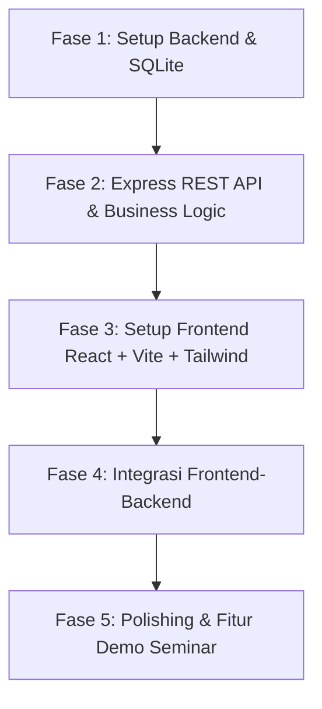

# Product Requirement Document (PRD): Mini KRS Mahasiswa

> **Keperluan**: Demo Seminar AI-Assisted Fullstack Development  
> **Target Pengguna**: Single-user (1 profil mahasiswa demo tanpa autentikasi)  
> **Tech Stack**: React + Vite + Tailwind CSS (Frontend), Express.js (Backend), SQLite (Database)

---

## 1. Ringkasan & Tujuan Produk

Aplikasi **Mini KRS Mahasiswa** dirancang khusus untuk demonstrasi alur pengembangan aplikasi fullstack modern berbantuan AI (*AI-assisted fullstack development*). Sistem ini mensimulasikan proses pengisian Kartu Rencana Studi (KRS) mahasiswa dengan fokus pada:
- Kejelasan arsitektur fullstack dan pemisahan *concern* (Frontend, Backend API, SQLite).
- Implementasi *business logic* yang ketat (validasi batas maksimal 24 SKS).
- Kemudahan demonstrasi seminar (tersedia fitur simulasi approval dosen PA dan reset data demo).

---

## 2. Fitur Utama & Acceptance Criteria (AC)

### F1: Katalog & Daftar Mata Kuliah
* **Deskripsi**: Menampilkan daftar mata kuliah yang tersedia untuk diambil beserta kode, nama, bobot SKS, dan jadwal.
* **Acceptance Criteria**:
  - `[AC-1.1]` Menampilkan tabel/kartu mata kuliah dengan kolom: Kode, Nama MK, SKS, Semester, Hari/Jam.
  - `[AC-1.2]` Memberikan indikator visual atau menonaktifkan tombol jika mata kuliah sudah masuk ke dalam daftar KRS yang dipilih.

### F2: Tambah & Hapus Mata Kuliah ke/dari KRS
* **Deskripsi**: Mahasiswa dapat memilih mata kuliah untuk dimasukkan ke draft KRS atau membatalkannya.
* **Acceptance Criteria**:
  - `[AC-2.1]` Tombol **"Ambil"** menambahkan mata kuliah ke draft KRS.
  - `[AC-2.2]` Tombol **"Hapus/Batal"** mengeluarkan mata kuliah dari draft KRS.
  - `[AC-2.3]` Mata kuliah yang sama tidak dapat diambil dua kali (*duplicate check*).

### F3: Validasi Batas Maksimal SKS (Maks 24 SKS)
* **Deskripsi**: Menghitung akumulasi total SKS secara real-time dan mencegah penambahan jika melebihi batas 24 SKS.
* **Acceptance Criteria**:
  - `[AC-3.1]` Menampilkan counter total SKS terpilih (format: `X / 24 SKS`) dengan indikator progress bar visual.
  - `[AC-3.2]` Di sisi Frontend, tombol "Ambil" otomatis disabled atau menampilkan alert error jika penambahan MK membuat total SKS > 24.
  - `[AC-3.3]` Di sisi Backend, request penambahan MK ditolak dengan kode HTTP `400 Bad Request` jika total SKS melampaui 24.

### F4: Simpan & Status Pengajuan KRS
* **Deskripsi**: Menyimpan draft KRS ke database dan mengajukannya untuk disetujui Dosen Pembimbing Akademik (PA).
* **Acceptance Criteria**:
  - `[AC-4.1]` Terdapat tombol aksi **"Simpan Draft"** dan **"Ajukan KRS"**.
  - `[AC-4.2]` Status pengajuan memiliki 3 kondisi:
    - `DRAFT`: Mahasiswa bebas menambah dan menghapus mata kuliah.
    - `SUBMITTED`: Menunggu persetujuan Dosen PA; daftar KRS terkunci (*read-only*).
    - `APPROVED`: Disetujui Dosen PA; daftar KRS terkunci resmi.
  - `[AC-4.3]` Terdapat kontrol demo seminar:
    - **"Simulasi Setujui PA"**: Mengubah status dari `SUBMITTED` menjadi `APPROVED`.
    - **"Reset Demo Data"**: Mengembalikan kondisi KRS mahasiswa ke draft kosong/awal untuk pengujian berulang di panggung seminar.

---

## 3. Struktur Data (SQLite Schema)

### 3.1. Tabel `courses` (Master Mata Kuliah)
Menyimpan daftar seluruh mata kuliah yang ditawarkan pada semester berjalan.

```sql
CREATE TABLE courses (
  id INTEGER PRIMARY KEY AUTOINCREMENT,
  code TEXT UNIQUE NOT NULL,
  name TEXT NOT NULL,
  credits INTEGER NOT NULL,
  schedule TEXT NOT NULL
);
```

### 3.2. Tabel `krs_submissions` (Header Pengajuan Mahasiswa Demo)
Menyimpan data identitas profil tunggal dan status KRS mahasiswa.

```sql
CREATE TABLE krs_submissions (
  id INTEGER PRIMARY KEY DEFAULT 1,
  student_name TEXT NOT NULL,
  nim TEXT NOT NULL,
  total_credits INTEGER DEFAULT 0,
  status TEXT NOT NULL CHECK(status IN ('DRAFT', 'SUBMITTED', 'APPROVED')) DEFAULT 'DRAFT',
  updated_at DATETIME DEFAULT CURRENT_TIMESTAMP
);
```

### 3.3. Tabel `krs_items` (Detail Mata Kuliah Terpilih)
Menyimpan relasi mata kuliah yang telah dimasukkan ke dalam KRS.

```sql
CREATE TABLE krs_items (
  id INTEGER PRIMARY KEY AUTOINCREMENT,
  submission_id INTEGER NOT NULL DEFAULT 1,
  course_id INTEGER NOT NULL,
  created_at DATETIME DEFAULT CURRENT_TIMESTAMP,
  FOREIGN KEY (submission_id) REFERENCES krs_submissions(id) ON DELETE CASCADE,
  FOREIGN KEY (course_id) REFERENCES courses(id) ON DELETE CASCADE,
  UNIQUE(submission_id, course_id)
);
```

---

## 4. Spesifikasi REST API (Express.js)

Base URL: `/api`

| Method | Endpoint | Deskripsi | Request Body / Param | Response Payload Utama |
| :--- | :--- | :--- | :--- | :--- |
| `GET` | `/courses` | Mengambil seluruh katalog mata kuliah yang tersedia | - | `[{ "id": 1, "code": "IF2101", "name": "Pemrograman Web", "credits": 3, "schedule": "Senin 08.00-10.30" }]` |
| `GET` | `/krs` | Mengambil status pengajuan KRS, profil, dan item MK terpilih | - | `{ "student_name": "...", "nim": "...", "status": "DRAFT", "total_credits": 6, "items": [...] }` |
| `POST` | `/krs/items` | Menambah mata kuliah ke dalam draft KRS | `{ "course_id": 2 }` | Status `201 Created` atau Error `400` ("Total SKS melebihi batas 24 SKS") |
| `DELETE` | `/krs/items/:course_id` | Menghapus mata kuliah dari draft KRS | URL Param: `course_id` | Status `200 OK` (mengembalikan data KRS terbaru) |
| `PATCH` | `/krs/status` | Mengubah status alur KRS (`SUBMITTED` / `APPROVED` / `DRAFT`) | `{ "status": "SUBMITTED" }` | `{ "status": "SUBMITTED", "updated_at": "..." }` |
| `POST` | `/krs/reset` | Mereset KRS kembali ke kondisi awal (fitur panggung seminar) | - | `{ "message": "Demo data berhasil direset" }` |

---

## 5. Rencana & Urutan Implementasi (Step-by-Step)



1. **Fase 1: Setup Backend & Database SQLite**
   - Inisialisasi package backend dengan Express.js dan SQLite (misal `better-sqlite3`).
   - Buat skrip otomatis migrasi tabel (`courses`, `krs_submissions`, `krs_items`).
   - Sediakan seed data: 8-10 mata kuliah variatif (2-4 SKS) dan 1 mahasiswa demo.

2. **Fase 2: Implementasi REST API & Validasi Business Rules**
   - Buat handler endpoint katalog (`/api/courses`) dan KRS (`/api/krs`).
   - Terapkan validasi backend:
     - Kunci mutasi jika status bukan `DRAFT`.
     - Tolak penambahan jika `total_credits + new_credits > 24`.
     - Cegah duplikasi mata kuliah.
   - Implementasikan endpoint kontrol status (`PATCH /api/krs/status`) dan reset (`POST /api/krs/reset`).

3. **Fase 3: Setup Frontend (React + Vite + Tailwind CSS)**
   - Inisialisasi template React Vite dan konfigurasi Tailwind CSS.
   - Buat komponen layout 2-kolom:
     - **Kolom Kiri**: Katalog Mata Kuliah (search/filter, card/tabel, tombol "Ambil").
     - **Kolom Kanan**: Kartu Rencana Studi (info mahasiswa, progress bar kapasitas 24 SKS, daftar terpilih, status badge).

4. **Fase 4: Integrasi Frontend-Backend**
   - Hubungkan state React ke API Express.
   - Terapkan dynamic badge status (`DRAFT` abu-abu, `SUBMITTED` kuning/oranye, `APPROVED` hijau).
   - Terapkan dynamic button disable saat SKS mencapai limit atau status bukan draft.

5. **Fase 5: Fitur Interaktif Demo Seminar**
   - Tombol cepat **"Simulasikan Persetujuan Dosen PA"** untuk mengubah status menjadi disetujui.
   - Tombol **"Reset Demo Data"** dengan konfirmasi toast untuk mengulang demo kapan saja di hadapan audiens.
